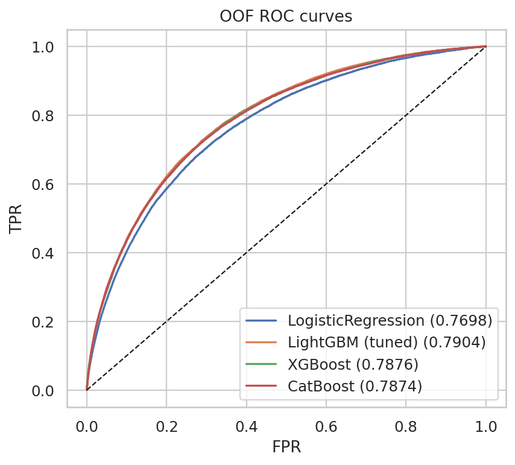
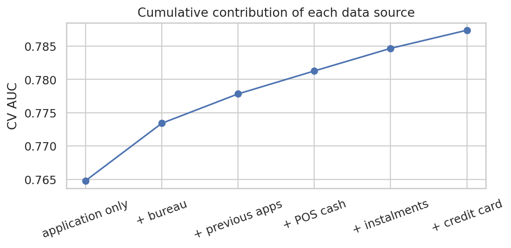
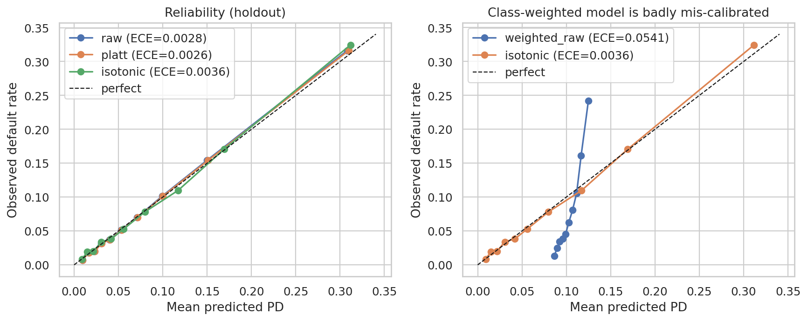
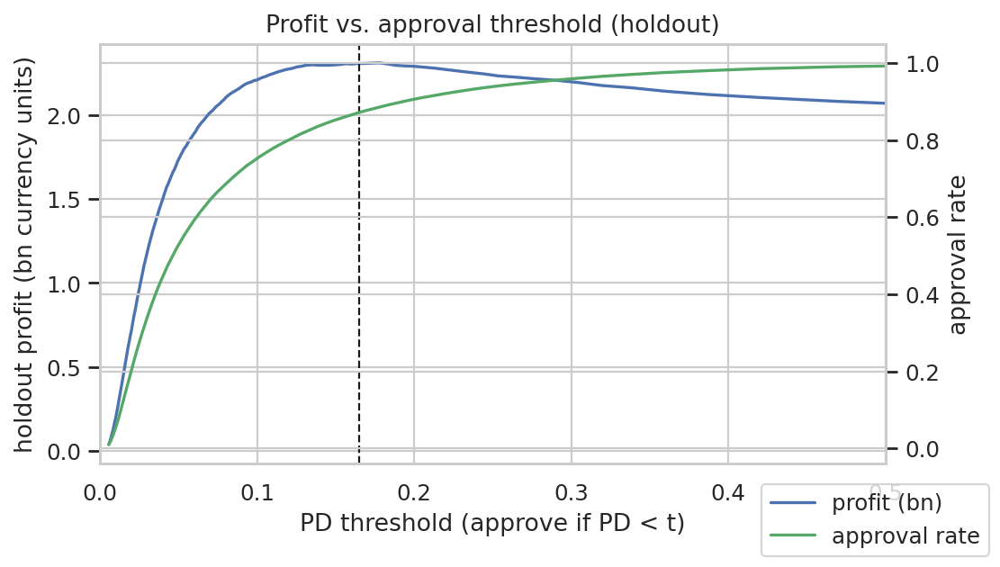
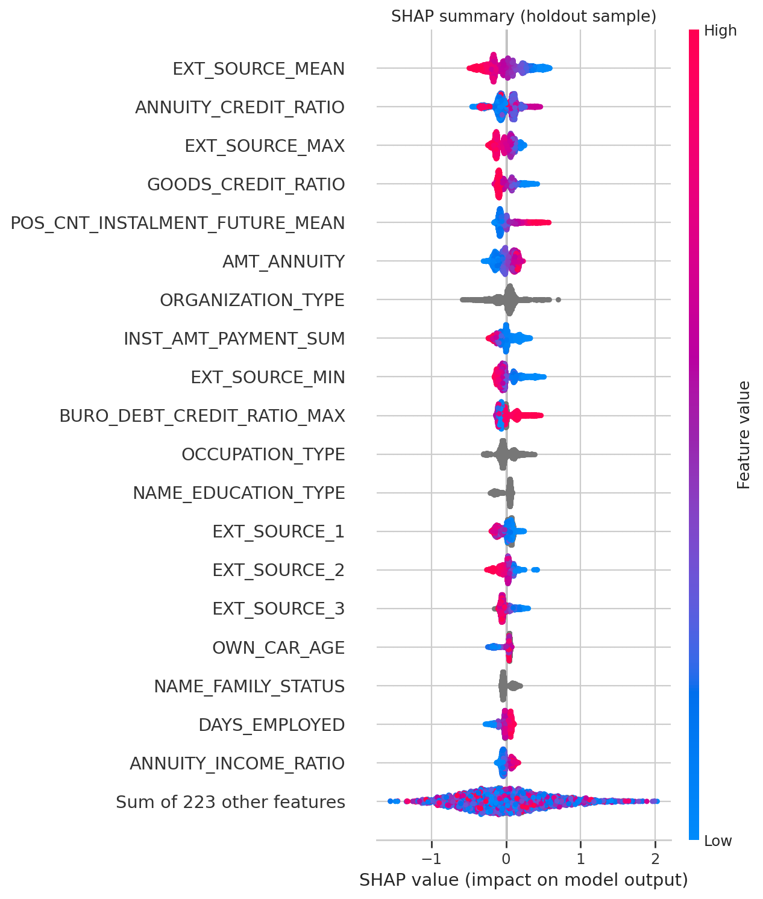
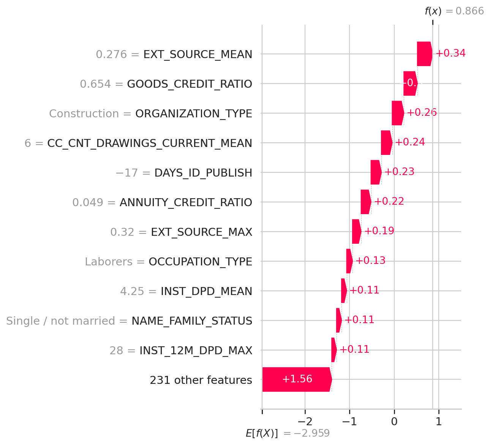
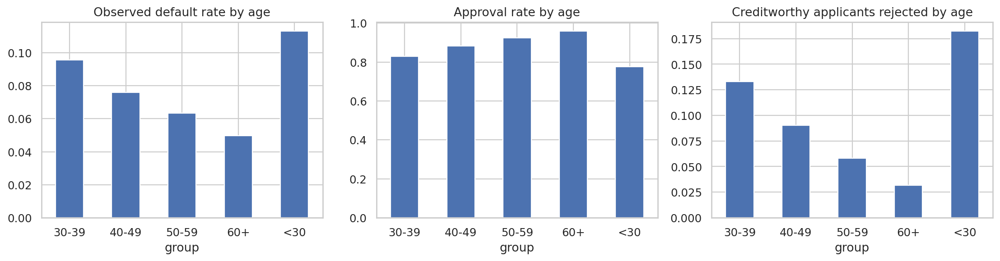
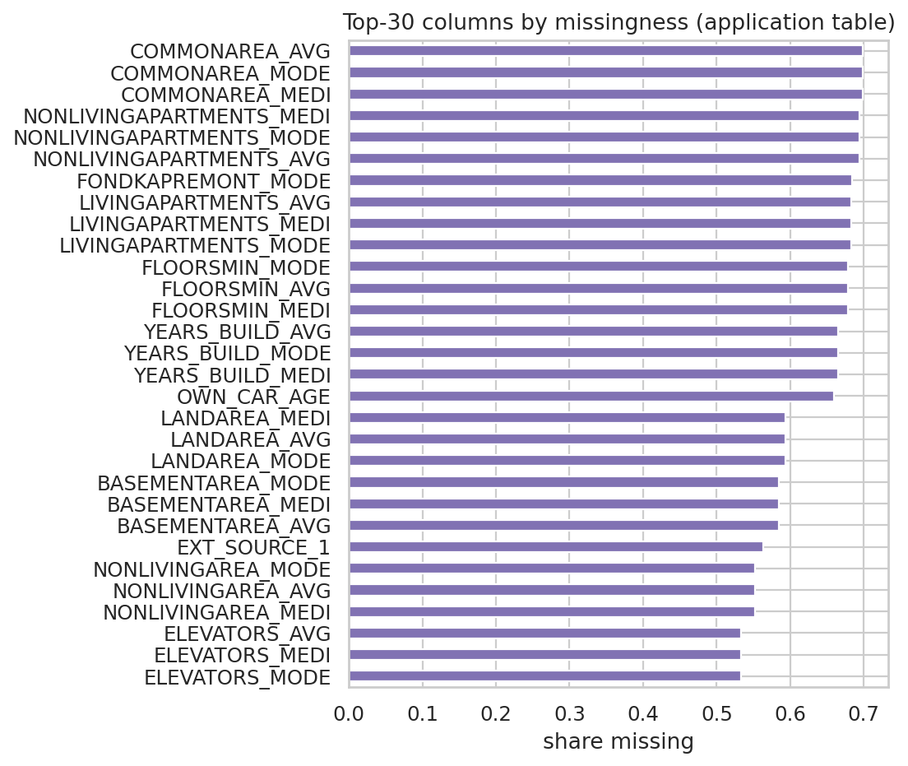

# Credit default risk: a calibrated, explainable and fairness-audited ML system

End-to-end credit-risk modelling on the **Home Credit Default Risk** dataset (307,511 loan applications,
7 relational tables, 8% default rate). Most Kaggle notebooks stop at AUC. This project goes further and treats
the model as a **decision system**:

1. **Relational feature engineering**: 242 applicant-level features aggregated from credit-bureau history, previous applications, instalment payments, POS and credit-card balances.
2. **Rigorous model comparison**: logistic regression vs. LightGBM / XGBoost / CatBoost under 5-fold stratified CV, Optuna tuning, rank blending, and an ablation of each data source's contribution.
3. **Calibration**: Platt vs. isotonic, fit on out-of-fold predictions. It also shows why class re-weighting breaks probability estimates.
4. **Business decisions**: a profit-maximising approval threshold, checked against decision theory (approve iff PD < m/(m+LGD)), with a sensitivity analysis.
5. **Explainability**: SHAP global and local explanations, plus plain-language *reason codes* for rejected applicants (adverse-action notices).
6. **Fairness audit**: approval rates and error rates by gender and age. It includes a proxy test showing that "fairness through unawareness" fails, and post-processing mitigations with their measured profit cost.
7. **Interactive demo**: a Gradio app showing PD, the decision and reason codes for any applicant.

## Results (holdout, 61,503 applicants; full write-up in [`reports/report.md`](reports/report.md))

| Model | AUC | Gini | KS |
|---|---|---|---|
| Logistic regression baseline | 0.7738 | 0.548 | 0.412 |
| LightGBM / XGBoost / CatBoost (default) | 0.792–0.793 | 0.585 | 0.44 |
| **LightGBM (Optuna-tuned), deployed** | **0.7934** | **0.587** | **0.445** |
| Rank blend of 3 GBMs | 0.7941 | 0.588 | 0.447 |

**Key findings**
* **The data matters more than the algorithm.** The relational tables add +0.023 AUC (0.765 → 0.787), while the three boosting libraries differ by < 0.001.
* **Class re-weighting backfired.** It cut AUC (0.789 → 0.732) and made calibration about 20× worse (ECE 0.054 vs 0.0028). Handle asymmetric costs at the threshold instead.
* **Calibrated PDs lead to the decisions theory predicts.** The empirical profit-optimal threshold is 0.165 against a theoretical 0.167. At 87% approval it cuts the bad rate among approved loans from 8.07% to 5.01% (−38%).
* **"Fairness through unawareness" fails.** Gender is not a model input, yet the other features predict it with AUC 0.90. Creditworthy men are falsely rejected 1.5× as often as creditworthy women, and applicants under 30 are falsely rejected 5.7× as often as those over 60.
* **The price of fairness is small.** Equal-opportunity thresholds close 89% of the gender false-rejection gap for −0.55% profit (with a legal caveat; see the report).

## Figures
| | |
|---|---|
|  |  |
| *Out-of-fold ROC curves: boosting vs logistic regression* | *Each relational table adds AUC* |
|  |  |
| *Reliability: Platt-calibrated vs class-weighted model* | *Holdout profit vs approval threshold* |
|  |  |
| *SHAP: global drivers of default risk* | *Explanation for a rejected applicant* |
|  |  |
| *Approval and false-rejection rates by age* | *Data quality: missing values* |

## Repository layout
```
src/creditrisk/   data.py  features.py  models.py  evaluate.py  fairness.py  explain.py  synthetic.py
notebooks/        01_data_eda_features  02_modeling  03_calibration_explainability_fairness  04_demo_app
app/app.py        Gradio demo
reports/          results_summary.md (auto-generated), figures/, model_card.md, report.md
scripts/          build_notebooks.py (generates the notebooks), smoke_test.py (runs all notebooks on synthetic data)
```

## How to run (Google Colab)
1. Upload the `credit-risk` folder to `MyDrive/masters-projects/credit-risk`.
2. On Kaggle, accept the [competition rules](https://www.kaggle.com/competitions/home-credit-default-risk/rules). Then go to *Settings → API → Create New Token* and save `kaggle.json` to `MyDrive/masters-projects/kaggle.json`.
3. Run notebooks 01 → 04 in order. Notebook 02 should use a T4 GPU runtime; the others are fine on CPU. Every artifact is saved to `artifacts/` on Drive, so you can stop and resume between notebooks.

Local smoke test without the data (runs the whole pipeline on synthetic tables in about 1 minute):
```bash
pip install -r requirements.txt nbclient ipykernel && python scripts/smoke_test.py
```

## Methodology notes
* **Leakage control:** the holdout split (20%, stratified) is made once in notebook 01 and evaluated only in notebook 03. Calibrators, thresholds, blend weights and fairness thresholds are all fit on out-of-fold predictions from the training split.
* **Protected attributes:** `CODE_GENDER` is excluded from the model's features but kept for auditing. Age is used as a feature, as in many real scorecards, and is audited.
* **Business assumptions:** a 10% margin on repaid loans and a 50% loss given default. These are stated assumptions, not estimates, and a sensitivity table varies them.
