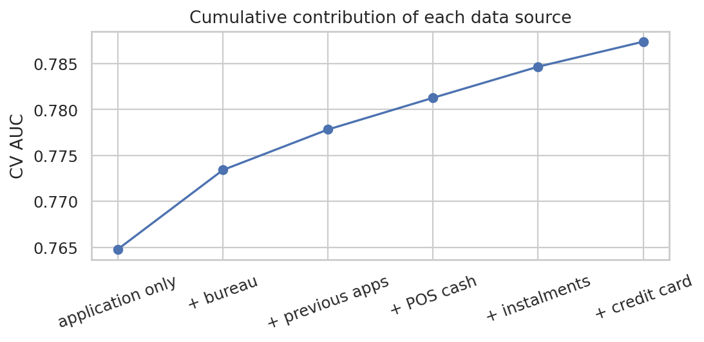
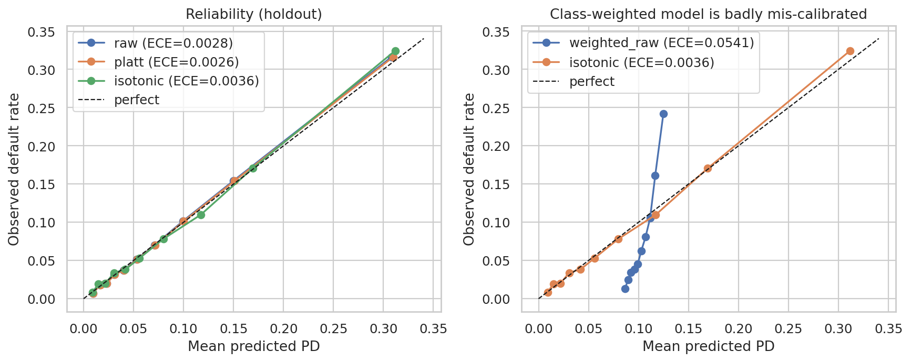
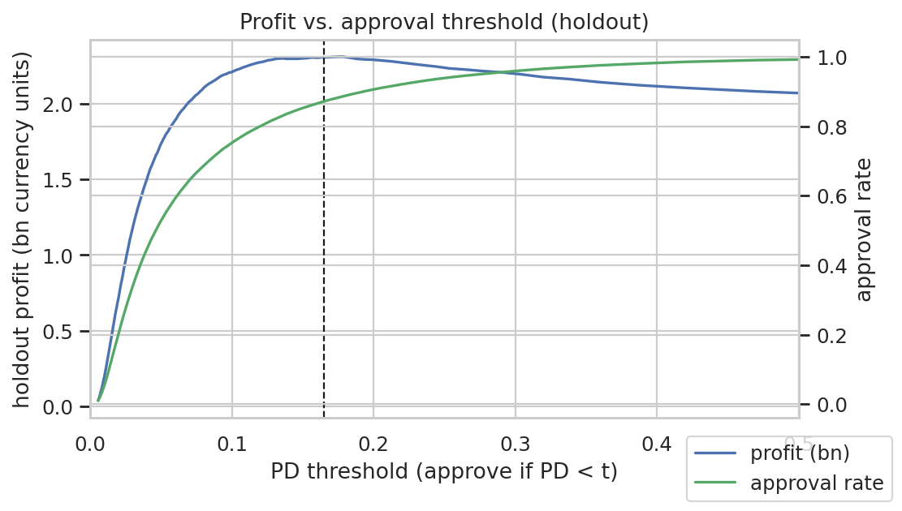
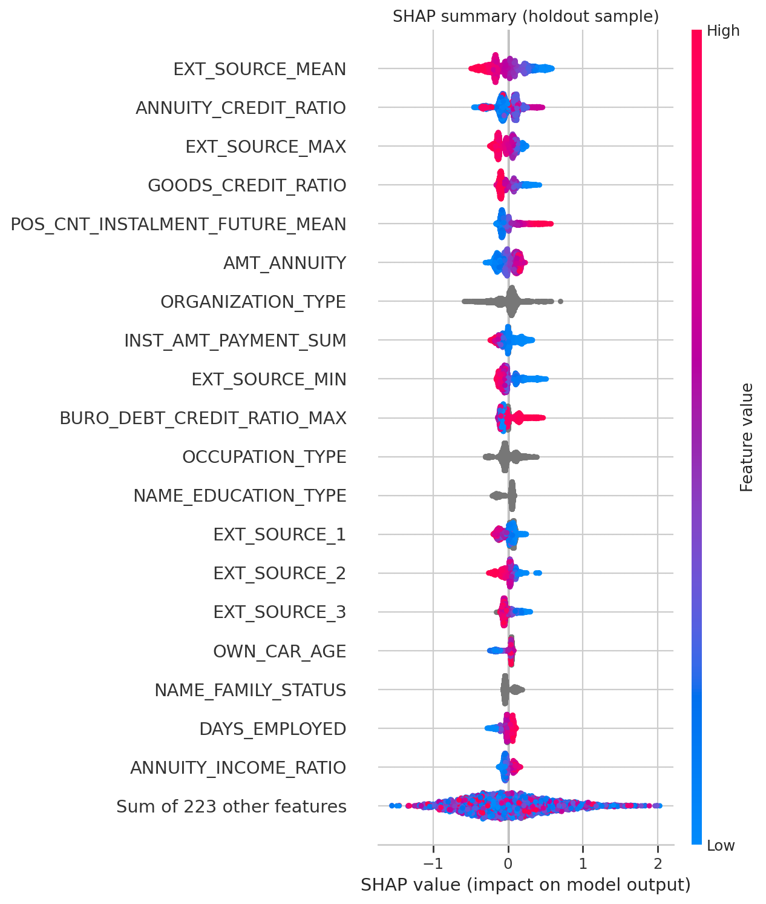
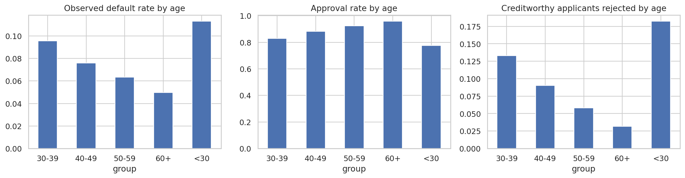

# From Scores to Decisions: A Calibrated, Explainable and Fairness-Audited Credit-Risk Model

**Author:** _Your Name_ · **Code:** _github.com/your-username/credit-risk_ · **Data:** Home Credit Default Risk (Kaggle)

## Abstract
Credit-scoring models are usually judged by AUC, but a lender acts on *decisions*: who gets a loan, how wrong
a predicted probability can be, why an applicant was rejected, and whether some groups are treated worse than others.
This project builds an end-to-end pipeline on 307,511 loan applications across 7 relational tables. A tuned LightGBM model
reaches **0.793 holdout AUC** (Gini 0.587, KS 0.445), against 0.774 for a logistic-regression baseline. Its probabilities are
well calibrated (ECE 0.0026), and the profit-maximising approval threshold we find empirically (PD < 0.165) matches
the decision-theoretic optimum (0.167). A fairness audit shows that removing gender as a feature does not remove gender
information: the remaining features predict gender with AUC 0.90. Creditworthy applicants under 30 are rejected 5.7×
as often as those over 60. A post-processing policy that equalises false-rejection rates between genders closes 89% of the gap at a
**0.55% profit cost**.

## 1. Data and setup
* **Data:** 307,511 applicants, a default rate of 8.07% (11.4:1 class imbalance), one application table plus six tables of
  history: credit-bureau loans and their monthly status, previous applications, POS/cash balances, instalment
  payments, and credit-card balances.
* **Split:** a stratified 80/20 train/holdout split (246,008 / 61,503). Model selection, calibration, threshold choice, blend
  weights and fairness thresholds are fit *only* on 5-fold out-of-fold (OOF) predictions from the training split. The
  holdout is evaluated once.
* **Features:** 242 per-applicant features. They are aggregates of each applicant's history (counts, sums, extremes, ratios,
  recent-12-month behaviour) plus domain ratios (credit/income, annuity/credit as a proxy for loan term, combined external scores).
  Data-quality fixes: the `365243` "not applicable" sentinel affects 18% of `DAYS_EMPLOYED`, almost all pensioners. It is
  replaced by NaN plus a flag. `CODE_GENDER` is excluded from the model's features and kept for auditing only.

## 2. Models
| Model (holdout) | AUC | Gini | KS | PR-AUC |
|---|---|---|---|---|
| Logistic regression (L2, imputed + one-hot) | 0.7738 | 0.548 | 0.412 | 0.263 |
| LightGBM (default) | 0.7924 | 0.585 | 0.442 | 0.296 |
| XGBoost | 0.7922 | 0.584 | 0.445 | 0.295 |
| CatBoost | 0.7925 | 0.585 | 0.444 | 0.294 |
| **LightGBM (Optuna-tuned)** | **0.7934** | **0.587** | **0.445** | **0.297** |
| Rank blend (LGBM + XGB + Cat) | 0.7941 | 0.588 | 0.447 | 0.298 |

Cross-validation was very stable (fold standard deviation ≤ 0.0015 AUC), and the CV and holdout estimates agree to within 0.003.
Gradient boosting beats the linear baseline by +0.020 AUC. The three boosting libraries are within 0.0003 of each other,
so the remaining gains come from the features, not the algorithm. The blend adds only +0.0007, so we deploy the single
tuned LightGBM, which is simpler to explain and serve.

**Which data sources matter?** Adding the tables one at a time (3-fold CV):

| Features | # | CV AUC | Δ |
|---|---|---|---|
| Application only | 135 | 0.7648 | |
| + credit bureau | 172 | 0.7734 | +0.0086 |
| + previous applications | 195 | 0.7778 | +0.0044 |
| + POS / cash | 203 | 0.7813 | +0.0035 |
| + instalment payments | 226 | 0.7847 | +0.0034 |
| + credit card | 238 | 0.7874 | +0.0027 |

Every table helps, and bureau history helps most. Together the relational features add +0.023 AUC, more than the
whole gap between logistic regression and gradient boosting.

**Class imbalance.** Up-weighting defaulters (`scale_pos_weight` ≈ 11.4) is a common default. Here it *hurt*: OOF AUC
fell from 0.789 to 0.732, and probability calibration became about 20× worse (ECE 0.054 vs 0.0028). The calibration damage
is expected, because weighting changes the implied base rate. The AUC drop is larger than usually reported. A likely cause is that
early stopping on the *weighted* log-loss stopped training at a worse point for ranking; we did not investigate further.
The practical lesson: train unweighted and handle the asymmetric costs at the **decision threshold**.

## 3. Calibration and the decision policy
Because a lender prices and approves loans on the probability of default (PD), predicted probabilities must match observed default rates.
The unweighted LightGBM was already well calibrated (holdout ECE 0.0028). Platt scaling fit on the OOF predictions
improved it slightly (ECE 0.0026, Brier 0.0651). Isotonic regression was slightly worse (0.0036), most likely from
overfitting its step function.

**Profit-maximising threshold.** Assumptions (stated, not estimated): a repaid loan earns 10% of the credit amount, and a
default loses 50% (loss given default, LGD). Approving an applicant is profitable iff (1−PD)·0.10 > PD·0.50, i.e. PD < 0.167.
Searching thresholds on the OOF predictions gives **0.165**, almost exactly the theoretical value, which independently confirms
that the PDs are calibrated. Over 12 margin/LGD scenarios (margin 5–20%, LGD 30–70%) the empirical optimum stays within
about 0.02 of theory.

On the holdout, the policy approves **87.1%** of applicants. The default rate among approved loans falls from 8.07%
to **5.01%** (−38%), and profit rises by 295M currency units compared with approving everyone.

## 4. Explainability
SHAP (TreeExplainer) on a holdout sample. The strongest drivers are the external credit scores (mean, max, min and
individual scores), the loan term (annuity/credit ratio), the goods-price/credit ratio, remaining POS instalments,
employer and occupation type, total instalment repayments, and the maximum bureau debt ratio. For every applicant the
system produces *reason codes*: the top features pushing risk up, in plain language. These resemble what an
adverse-action notice must contain under consumer-credit regulation (e.g. the US ECOA), and the demo app shows them live.
SHAP explains the *model*, not causal effects, so reason codes should not be read as advice ("raise X to get approved").

## 5. Fairness audit
Decision: approve if PD < 0.165. Groups: gender (not a model input) and age band (a model input).

**Gender.** Men default more (10.2% vs 7.0%), and the model ranks both groups about equally well (AUC 0.791 vs 0.789).
At a single threshold, men are approved less often (83.3% vs 89.0%; ratio 0.94, above the "four-fifths" rule of thumb). But
**creditworthy men are wrongly rejected 1.49× as often as creditworthy women** (12.8% vs 8.6%), which violates
equal opportunity.

**Removing gender doesn't make the model gender-blind.** The other features predict gender with **AUC 0.903**
(occupation, organisation type, car ownership, …). Leaving gender out still *reduces* disparities: compared with a model
that uses it, the approval gap shrinks from 8.0 to 5.3 percentage points (pp) and the false-rejection gap from 6.3 to 3.9 pp, at a cost of
0.0016 AUC. Unawareness helps partially, but because of proxies it cannot remove the disparity.

**Age.** Disparities are larger here. Creditworthy applicants under 30 are rejected 18.2% of the time, against 3.2% for over-60s
(5.7×). The approval-rate ratio is 0.81, close to the four-fifths threshold. Some of this reflects real differences in risk
(default rate 11.3% vs 5.0%), but the model is also *less accurate* for the youngest and oldest groups (AUC 0.770
and 0.748 vs about 0.80 for ages 30–49). That suggests these groups are under-served by the data (thin credit files)
and are not only higher-risk.

**Mitigation (gender, post-processing).** Group-specific thresholds fit on the OOF predictions and evaluated on the holdout:

| Policy | Thr. F / M | Approval | False-rejection gap | Approval gap | Profit Δ |
|---|---|---|---|---|---|
| Single threshold | 0.165 / 0.165 | 87.1% | 4.20 pp | 5.71 pp | — |
| Equal opportunity | 0.150 / 0.193 | 87.3% | **0.47 pp** | 0.50 pp | **−0.55%** |
| Demographic parity | 0.148 / 0.197 | 87.2% | 1.09 pp | **0.22 pp** | −0.68% |

Equal opportunity removes about 89% of the false-rejection gap for under 1% of profit. **Caveat:** group-specific
thresholds use the protected attribute at decision time, which is disparate treatment and illegal in many jurisdictions.
We report them to put a number on the *price* of fairness. Lawful options include removing proxy features, collecting
better data for thin-file groups, and in-training fairness constraints, which we leave to future work.

## 6. Limitations
* **Selection bias:** the data covers *approved* loans only. Outcomes for rejected applicants are unknown, and we did no reject inference.
* **Simplified profit model:** fixed margin and LGD, no time value of money, no loan-size-dependent costs.
* A single static snapshot; no monitoring for drift over time.
* Holdout AUC is not directly comparable to the Kaggle leaderboard, which uses a different test set.

## 7. Reproducibility
Four Colab notebooks (EDA/features → modelling → calibration/decisions/explainability/fairness → demo). All logic lives in
a tested Python package (`src/creditrisk`). A synthetic-data smoke test runs the whole pipeline in about 1 minute.
Fixed random seeds; every number in this report comes from the auto-generated `reports/results_summary.md`.
